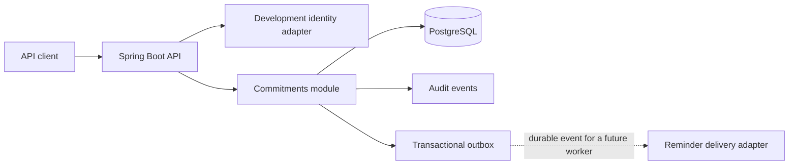

# Mandate Guardian

[](https://github.com/shreya011101/mandate-guardian/actions/workflows/ci.yml)

**A backend control tower for recurring financial commitments.**

Mandate Guardian gives a user one trustworthy view of recurring financial
obligations: what is due in the next 30 days, what needs a manual payment, and
what is expected to be collected automatically. It is deliberately **not** a
payment app: it does not hold funds, initiate transfers, or collect banking
credentials.

The project is a Java 21 / Spring Boot modular monolith that demonstrates the
engineering concerns behind dependable financial workflows: time zones,
idempotent writes, explicit state transitions, an audit trail, and transactional
outbox records.

## Why this exists

Recurring payments are easy to miss because they are distributed across bank
apps, provider dashboards, emails, and calendar reminders. A user needs a
simple answer to three questions:

1. How much money is expected to leave my account soon?
2. Which payments need me to act before their due date?
3. Can I trust the system to preserve the history of what I changed?

Mandate Guardian models a continuing **commitment** separately from an expected
**payment occurrence**, so a user can forecast an obligation before there is
evidence that it was paid.

## Features

- Create fixed-amount monthly commitments in INR for manual and auto-debit payments.
- Calculate due dates in the user's IANA time zone, including month-end edge cases.
- Create commitments idempotently: safe retries return the original result, while
  a reused key with changed request content is rejected.
- List payment occurrences for a requested month.
- Return a 1-90 day cash forecast with total expected amount, manual-action amount,
  auto-debit amount, and a due-date-ordered payment list.
- Apply explicit payment actions (`MARK_PAID`, `SKIP`, `POSTPONE`) rather than
  accepting arbitrary status updates.
- Write audit and transactional-outbox records in the same database transaction as
  a business change.
- Exercise database integration tests against PostgreSQL using Testcontainers.

## Architecture



The application is a modular monolith, not a collection of pretend
microservices. Modules are separated by business responsibility while a single
transaction protects a commitment, its first occurrence, its audit record, and
its outbox event from partial writes.

## Stack

- Java 21 and Spring Boot
- Spring MVC, Spring Security, Spring Data JPA, and Bean Validation
- PostgreSQL and Flyway migrations
- Spring Modulith
- Testcontainers with PostgreSQL
- Docker Compose and GitHub Actions

## Run locally

### Prerequisites

- Java 21 (Eclipse Temurin recommended)
- Docker Desktop
- Git

Maven does not need to be installed; the repository includes Maven Wrapper.

```bash
git clone https://github.com/shreya011101/mandate-guardian.git
cd mandate-guardian
docker compose up -d postgres
./mvnw spring-boot:run
```

Check readiness:

```bash
curl http://localhost:8080/actuator/health
```

The `local` profile uses HTTP Basic Auth as a development-only identity adapter:

```text
username: local-developer
password: local-development-only
```

Override these through `LOCAL_SECURITY_USERNAME` and
`LOCAL_SECURITY_PASSWORD`; see `.env.example` for database configuration.

## Quick demo

Create the authenticated user's profile and time zone:

```bash
curl --user local-developer:local-development-only \
  --request PUT http://localhost:8080/api/v1/me/profile \
  --header 'Content-Type: application/json' \
  --data '{"timeZone":"Asia/Kolkata"}'
```

Create a manual rent commitment. Amounts use minor units, so `2500000` means
INR 25,000.00:

```bash
curl --include --user local-developer:local-development-only \
  --request POST http://localhost:8080/api/v1/commitments \
  --header 'Content-Type: application/json' \
  --header 'Idempotency-Key: rent-2026-08-08' \
  --data '{
    "displayName":"Rent",
    "category":"RENT",
    "expectedAmountMinor":2500000,
    "currency":"INR",
    "dueDay":10,
    "paymentMode":"MANUAL"
  }'
```

View the next 30 days. The response separates cash that needs manual action
from expected auto-debits and returns the individual payment occurrences:

```bash
curl --user local-developer:local-development-only \
  'http://localhost:8080/api/v1/overview?days=30'
```

Mark a returned `occurrenceId` as paid:

```bash
curl --include --user local-developer:local-development-only \
  --request POST http://localhost:8080/api/v1/payment-occurrences/<occurrence-id>/actions \
  --header 'Content-Type: application/json' \
  --data '{"action":"MARK_PAID"}'
```

Full endpoint contracts and example responses are in [docs/API.md](docs/API.md).

## Engineering decisions

| Concern | Decision | Why it matters |
| --- | --- | --- |
| Money | Integer minor units plus ISO currency | Avoids floating-point rounding errors. |
| Dates | `LocalDate` in the user's IANA time zone | A due date is a calendar-day promise, not a UTC timestamp. |
| Retries | Idempotency key plus request fingerprint | Network retries do not create duplicate commitments. |
| Lifecycle | Commands model business actions | Invalid state changes cannot bypass domain rules. |
| Async work | Transactional outbox record | A reminder trigger cannot be lost after a committed business write. |
| Tests | Testcontainers PostgreSQL | Integration tests run against the production database family. |

The supporting product and architecture decisions live in
[docs/product](docs/product/) and [docs/adr](docs/adr/).

## Test

```bash
./mvnw verify
```

The test suite covers monthly-date edge cases, payment-occurrence transitions,
cash-forecast calculation, and a PostgreSQL-backed end-to-end workflow.

## Project structure

```text
src/main/java/com/mandateguardian/
  commitments/  commitment and payment-occurrence workflows
  identity/     user profile and time-zone ownership
  shared/       audit, idempotency, outbox, security, time, and web concerns
src/main/resources/db/migration/  Flyway schema migrations
src/test/                         unit and PostgreSQL integration tests
docs/                             API contract, product contract, and ADRs
```

## Deliberate limits and next steps

This is a portfolio backend, not a production banking product. It currently
supports fixed monthly INR commitments and a development-only identity adapter.
It does not move money, infer payments, or request credentials.

The next meaningful vertical slices are commitment pause/resume and edits, a
durable outbox worker that creates deduplicated reminder jobs, delivery through
an email sandbox, and a thin dashboard client. See
[docs/product/product-contract.md](docs/product/product-contract.md) for the
product boundaries.
